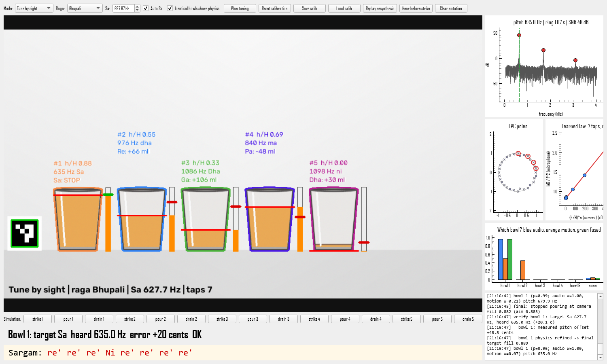

# TuneSight: seeing the note, hearing the water

**DA321 Multimodal Data Processing and Learning, IIT Guwahati: course project (sound + image).**
Author: **Kushagra Singhal**.

A jal tarang is a row of bowls tuned with water. TuneSight watches the bowls with a camera and listens with a microphone.
The camera reads how much water each bowl holds; the microphone hears the pitch of each strike. A physical law,
f = f₀ / √(1 + β uⁿ) (A. P. French, 1983), is **learned live from a few taps** and joins the two. With it, the system can:

- tell **which of several identical bowls was struck**, even though they all look the same;
- **tune the bowls to a raga by sight** ("pour 66 ml… STOP, tap… top up");
- **write the sargam** while someone plays;
- measure each **container's shape** (radius, height, capacity) and predict the pitch of a **new glass from its shape alone**;
- **hear the water level of an opaque cup** that the camera cannot see into.

**Live explainer:** <https://kushagra2606.github.io/TuneSight/> (GitHub Pages)



## Deliverables

| Deliverable | Where | Open it |
|---|---|---|
| 1. Code repository | this folder | `python -m pytest -q`, then any command below |
| 2. Interactive demo: explainer page with six ManimGL animations, architecture diagram and seven live in-browser demos | `web/index.html`, live at <https://kushagra2606.github.io/TuneSight/> | open in a browser (works offline; fonts need internet) |
| 2b. Live demo: desktop app with webcam + microphone | `app/app.py` | `python app/app.py` (or `--sim` without hardware) |
| 3. Slides: IITG Beamer template, 18 slides in the course's suggested order (motivation, history, key highlights, what I learned, reflections, references) | `slides/TuneSight_slides.pdf` | `python scripts/build_slides.py` rebuilds it |
| Results, all experiments | `results/RESULTS.md`, `results/metrics.json`, `results/figures/` | `python scripts/evaluate.py` |
| Design, novelty, model | `docs/DESIGN.md` | |
| Presenter's demo script | `docs/DEMO_SCRIPT.md` | |

## Results at a glance

Simulated experiments use a physics-based simulator with known ground truth; every figure is labelled SIMULATED or REAL.

| Question | Result |
|---|---|
| Pitch of a strike (40 dB SNR) | error **0.00 cents**; decay error 0.3 % (STFT) and 1.4 % (covariance LPC) |
| Does the data recover French's law? | Bayesian evidence selects **n = 4.25** (theory: 4) and the glass-base offset |
| Camera-only pitch prediction after calibration taps | 32 cents after 1 tap, **2.8 cents after 5**, 1.4 cents after 10 (median) |
| Water level from the camera | fill-ratio error 0.007 (clean), 0.009 at 4 px blur, 0.009 for clear water |
| Which of 5 identical glasses was struck (raga-tuned set, striker hidden) | **100 %** at 20 dB SNR, 96 % at 10 dB (audio through physics) |
| Same, at 0 dB SNR with the striker visible | fused **100 %** against 22 % for audio alone |
| Tune by sight, raga Bhupali (one verification tap) | mean error 12.7 → **8.4 cents** (near-identical glasses); 68.2 → **12.9 cents** when glasses differ by 3 % |
| Container shape from the camera (random glasses, radius 2.5-4.5 cm) | radius within **0.16 mm** (0.9 mm with the camera farther away), capacity within 4 % |
| A **new** glass's pitch from its shape (3 % wall-thickness spread) | shape ignored 375 cents; shape alone **45 cents**; one check tap **7 cents**; fitted radius exponent −2.01 (French: −2) |
| Water level of an **opaque** cup, heard (±8 cents tap variation) | within **1.2 %** of the height above 35 % full; 14 % below 30 %, where the law is too flat |
| Real recordings | ObjectFolder Real glass #91: both strikes agree on the lowest mode (225 / 224 Hz); modes, resynthesis, LPC poles |
| Live app, scripted end-to-end self-test | 8 of 8 strikes identified in every run; after one correction tap the tuned bowl ends 20-25 cents from its note |

## Quick start

```bash
# 0. get the code
git clone https://github.com/KUSHAGRA2606/TuneSight.git
cd TuneSight

# 1. environment (a separate one; it does not touch Anaconda)
uv venv --managed-python --python 3.12 .venv
uv pip install --python .venv -r requirements.txt
# below, "python" means .venv\Scripts\python.exe (Windows) or .venv/bin/python

# 2. check that everything works
python -m pytest -q                 # 19 automated checks

# 3. try it
python app/app.py --sim             # live demo with simulated glasses (keys 1-5 strike; pour/drain buttons)
python app/app.py                   # real: webcam + microphone (--camera 1 for a phone used as a webcam)
start web/index.html                # the interactive explainer (macOS: open, Linux: xdg-open)
```

## Reproduce everything

```bash
python scripts/evaluate.py          # all experiments (about 5-7 min) -> results/RESULTS.md, metrics.json, figures
python scripts/make_figures.py      # slide/web figures + numbers.tex/numbers.json from metrics.json
python scripts/build_slides.py      # -> slides/TuneSight_slides.pdf  (needs pdflatex + beamer)
python scripts/build_web.py         # -> web/index.html (numbers filled in from the experiments)

# animations (ManimGL, 3Blue1Brown's manim) in their own environment
uv venv --managed-python --python 3.12 .venv-manim
uv pip install --python .venv-manim -r requirements-manim.txt
.venv-manim/Scripts/python animations/render.py   # -> web/media/*.mp4 and posters
```

Optional real data:

```bash
python scripts/download_objectfolder.py --chunks 91_100 --max-gb 1   # a few real glass strikes
python scripts/download_objectfolder.py --chunks 61_70 41_50 --meshes # size families for the scaling law (fast connection)
```

Your own bowls (about an hour):

```bash
python scripts/make_marker.py                      # print results/marker_4cm.png with the black square at 4 cm
python scripts/record_session.py --name s1         # keys 1-9 choose the bowl, SPACE captures + records a strike
python scripts/calibrate.py data/own/s1 --shared   # fits the law -> models/calibration.json
python scripts/evaluate.py --session data/own/s1   # adds REAL results to RESULTS.md
python app/app.py                                  # loads the calibration
```

## How it works (one paragraph per sense)

- **Audio (source–filter):** the 2 ms tap is the source and the bowl is an all-pole filter. Modes come from zero-padded FFT peaks
  (with a local noise-floor test) and from the poles of a covariance-method LPC fit, which give frequency (angle) and damping (radius).
  A mode must start at the strike and decay, so hum and fans are ignored.
- **Vision (classical):** background by morphological closing, Otsu threshold, morphology and hole filling for bowl silhouettes,
  water line from the per-row HSV saturation (edge-step fallback for clear water), ArUco marker for cm and ml, striker tip
  as the lowest new pixel at impact.
- **Physics:** 1/f² = a + b uⁿ is linear in uⁿ, so taps (camera fill, heard pitch) feed a Bayesian linear regression whose closed-form evidence
  picks n and the base offset. One verification tap measures a bowl's pitch offset during tuning.
- **Fusion:** reliability-weighted log-linear pooling of the audio likelihood (heard pitch against each bowl's camera-predicted pitch)
  and the motion likelihood (striker tip), plus a "none of the visible bowls" hypothesis.
- **Any container (`tunesight/geometry.py`):** walls fitted to the outline give radius, height and capacity. French's thin-wall model
  says the empty pitch scales as a/R² and the water effect as R/a (a = wall thickness, hidden from the camera), so two constants shared
  by a family of glasses predict a new glass from its shape alone. Run backwards, the law turns a tap into the water level of an opaque cup.

Full details, novelty against published work, and limitations: [`docs/DESIGN.md`](docs/DESIGN.md).

## Repository layout

```
tunesight/        the library: audio, vision, geometry, physics, fusion, tuning, music, simulate, session, objectfolder, config
app/app.py        live desktop demo (PySide6 + pyqtgraph + OpenCV + sounddevice); --sim, --selftest
scripts/          evaluate, make_figures, build_slides, build_web, record_session, calibrate, download_objectfolder, make_marker
animations/       ManimGL scenes (scenes.py) and renderer (render.py)
web/              interactive explainer: src/index.template.html -> index.html, media/ (videos), assets/figures/
slides/           IITG Beamer deck: main.tex, segments/, ref.bib, images/, generated/numbers.tex
results/          RESULTS.md, metrics.json, figures/ (experiment figures; figures/slides/ vector PDFs)
tests/            pytest suite (19 checks)
docs/             DESIGN.md (idea, novelty, model), DEMO_SCRIPT.md (live demo)
data/             downloads and recorded sessions (not committed; see data/README.md)
```

## Environment notes

- **Python 3.12**, packages in `requirements.txt`. On Windows with Anaconda on the PATH, PySide6 can fail with
  "DLL load failed while importing QtCore"; a standalone Python from `uv` (as above) avoids it.
- **Slides** need `pdflatex` with `beamer`, `pgf`, `booktabs`, `lipsum`, `translator`. For TinyTeX 2025:
  `tlmgr --repository https://ftp.math.utah.edu/pub/tex/historic/systems/texlive/2025/tlnet-final install beamer pgf booktabs lipsum translator`.
- **ManimGL 1.7.2** needs `setuptools<81` (it imports `pkg_resources`) and ffmpeg; `animations/render.py` uses the ffmpeg binary from `imageio-ffmpeg` if none is installed.
- **Microphone:** if strikes are not detected, check that the microphone is not muted (a level near −97 dBFS means silence).
- **Headless screenshots of the app:** `QT_QPA_PLATFORM=offscreen QT_QPA_FONTDIR=C:/Windows/Fonts python app/app.py --selftest`.

## Credits

ObjectFolder Real (Gao et al., CVPR 2023) for real impact recordings · ManimGL by 3Blue1Brown for the animations ·
A. P. French, "In vino veritas", *Am. J. Phys.* 51 (1983) for the water-loading law · IITG Beamer template from the course.
The course PDFs in this folder are not part of the repository.
