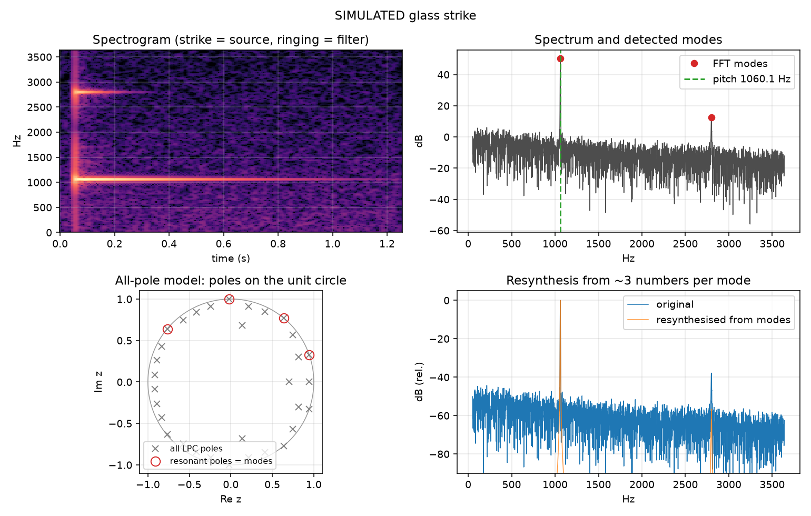
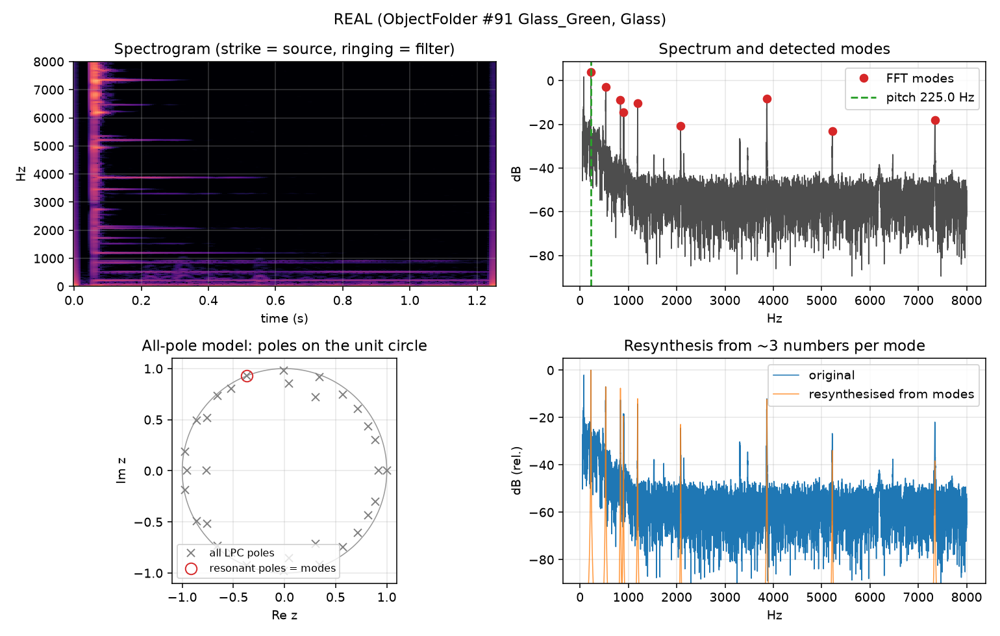
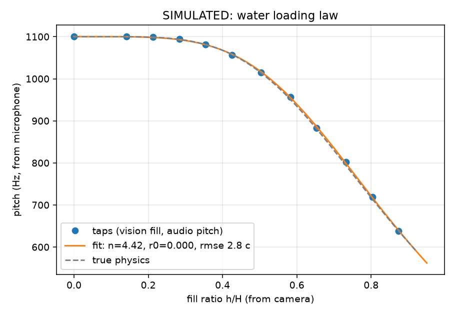
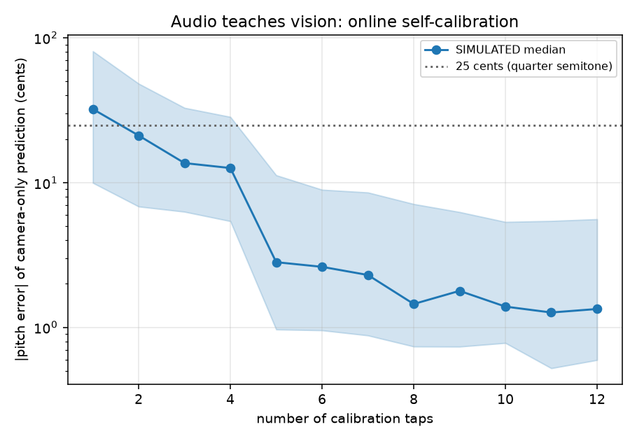
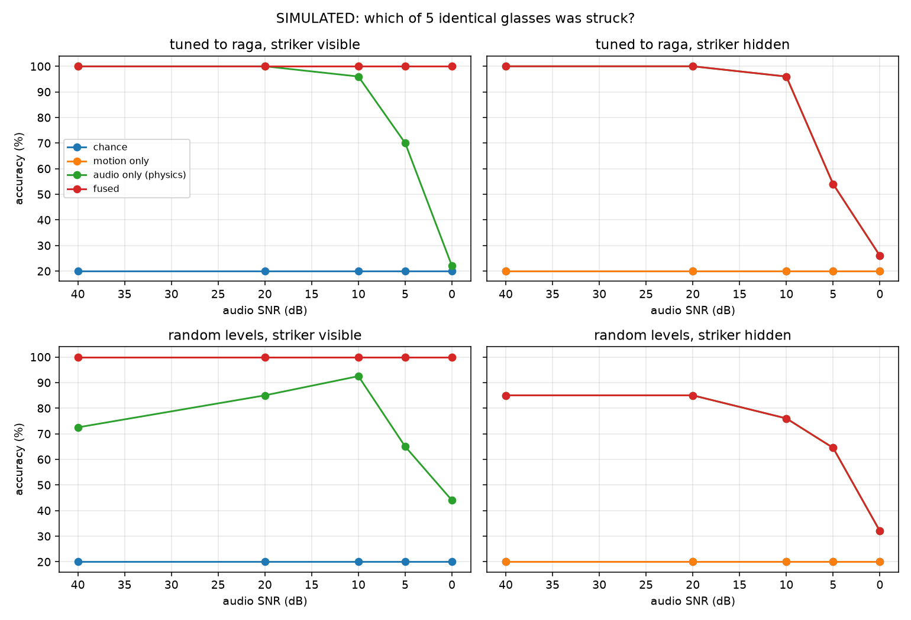
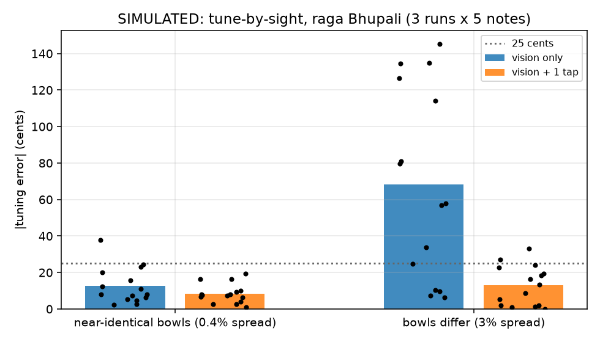

# TuneSight results

_generated 2026-11-24 22:01_

## E1 Audio model (SIMULATED ground truth)

| SNR (dB) | modes found | freq error (median cents) | decay error STFT (median %) | decay error LPC (median %) |
|---|---|---|---|---|
| 40 | 80% | 0.00 | 0.3 | 1.4 |
| 20 | 57% | 0.03 | 1.3 | 54.2 |
| 10 | 43% | 0.04 | 2.2 | 308.8 |

## E1 Audio model on REAL recordings (ObjectFolder Real)

Pitch is searched in the app's band (150 Hz to 8 kHz). Searching from 60 Hz instead, one glass #91 recording also shows a 79 Hz line (stand or room) only 6 dB below the glass's main mode, and a lowest-line pitch picker takes it as the pitch.

| # | object | material | strikes | pitch (Hz) | strikes agreeing on pitch | LPC vs FFT freq (cents) | LPC/STFT decay ratio | resynthesis spectral corr. |
|---|---|---|---|---|---|---|---|---|
| 91 | Glass_Green | Glass | 2 | 224.5 | 100% | 12.76 | 9.20 | 0.48 |

## E2 Scaling law
_skipped: needs ObjectFolder size-family audio chunks and meshes (`python scripts/download_objectfolder.py --chunks 61_70 41_50 --meshes`)._

## E3 Water-loading law

SIMULATED: fitted exponent n = 4.42 +- 0.15 (true 4.0), base offset r0 = 0.000, rmse 2.8 cents

Bayesian model evidence (online calibrator) selects n = 4.25, r0 = 0.02 (true n = 4; glass base offset about 0.05)

## E4 Vision: water level under degradations (SIMULATED)

| condition | level found | fill-ratio MAE |
|---|---|---|
| clean | 100% | 0.007 |
| blur 2px | 100% | 0.003 |
| blur 4px | 92% | 0.009 |
| blur 6px | 42% | 0.015 |
| dark x0.6 | 100% | 0.005 |
| dark x0.35 | 100% | 0.004 |
| noise 10 | 100% | 0.004 |
| clear water | 100% | 0.009 |

## E5 Audio teaches vision: camera-only pitch prediction vs calibration taps

| taps | SIMULATED |
|---|---|
| 1 | 32.2 c |
| 2 | 21.2 c |
| 3 | 13.7 c |
| 4 | 12.6 c |
| 5 | 2.8 c |
| 6 | 2.6 c |
| 7 | 2.3 c |
| 8 | 1.5 c |
| 9 | 1.8 c |
| 10 | 1.4 c |
| 11 | 1.3 c |
| 12 | 1.3 c |

## E6 Which identical-looking bowl was struck? (SIMULATED, 5 glasses 9.5 cm apart)

| condition | chance | motion only | audio only (physics) | fused |
|---|---|---|---|---|
| tuned to raga | striker visible | SNR 40 dB | 20% | 100% | 100% | 100% |
| tuned to raga | striker visible | SNR 20 dB | 20% | 100% | 100% | 100% |
| tuned to raga | striker visible | SNR 10 dB | 20% | 100% | 96% | 100% |
| tuned to raga | striker visible | SNR 5 dB | 20% | 100% | 70% | 100% |
| tuned to raga | striker visible | SNR 0 dB | 20% | 100% | 22% | 100% |
| tuned to raga | striker hidden | SNR 40 dB | 20% | 20% | 100% | 100% |
| tuned to raga | striker hidden | SNR 20 dB | 20% | 20% | 100% | 100% |
| tuned to raga | striker hidden | SNR 10 dB | 20% | 20% | 96% | 96% |
| tuned to raga | striker hidden | SNR 5 dB | 20% | 20% | 54% | 54% |
| tuned to raga | striker hidden | SNR 0 dB | 20% | 20% | 26% | 26% |
| random levels | striker visible | SNR 40 dB | 20% | 100% | 72% | 100% |
| random levels | striker visible | SNR 20 dB | 20% | 100% | 85% | 100% |
| random levels | striker visible | SNR 10 dB | 20% | 100% | 92% | 100% |
| random levels | striker visible | SNR 5 dB | 20% | 100% | 65% | 100% |
| random levels | striker visible | SNR 0 dB | 20% | 100% | 44% | 100% |
| random levels | striker hidden | SNR 40 dB | 20% | 20% | 85% | 85% |
| random levels | striker hidden | SNR 20 dB | 20% | 20% | 85% | 85% |
| random levels | striker hidden | SNR 10 dB | 20% | 20% | 76% | 76% |
| random levels | striker hidden | SNR 5 dB | 20% | 20% | 64% | 64% |
| random levels | striker hidden | SNR 0 dB | 20% | 20% | 32% | 32% |

## E7 Tune by sight (SIMULATED), raga Bhupali, 5 bowls

| bowls | vision only: mean / max abs error | vision + 1 tap: mean / max abs error |
|---|---|---|
| near-identical bowls (0.4% spread) | 12.7 / 37.8 cents | 8.4 / 19.3 cents |
| bowls differ (3% spread) | 68.2 / 145.2 cents | 12.9 / 33.0 cents |

Example run (near-identical bowls), Sa = 630.6 Hz:

| note | target (Hz) | vision only (cents) | vision + 1 tap (cents) |
|---|---|---|---|
| Sa | 630.6 | +7.4 | -16.3 |
| Re | 709.4 | -2.4 | -2.6 |
| Ga | 788.2 | +12.5 | -7.6 |
| Pa | 945.9 | +8.1 | -6.6 |
| Dha | 1051.0 | +23.2 | +4.0 |

## E8 Container shape from the camera (SIMULATED, random glasses: radius 2.5-4.5 cm, height 7-12 cm)

| camera | found | mean radius error | rim radius error | height error | capacity error |
|---|---|---|---|---|---|
| 18 px/cm | 100% | 0.16 mm | 0.29 mm | 2.9 mm | 4.0 % |
| 12 px/cm | 100% | 0.91 mm | 1.01 mm | 4.9 mm | 10.7 % |
| 18 px/cm, blur 2 px | 100% | 0.28 mm | 0.64 mm | 3.3 mm | 5.8 % |

## E9 A new container's pitch from its shape (SIMULATED, leave one container out)

French's thin-wall model: empty pitch ~ 1/R^2, water effect ~ R. Two family constants are fitted on the other containers; fitted radius exponent -2.01 (theory -2).

| family | family average, shape ignored | shape, zero taps | shape + 1 check tap |
|---|---|---|---|
| 0% wall-thickness spread | 396.1 cents | 11.8 cents | 6.0 cents |
| 3% wall-thickness spread | 375.2 cents | 44.6 cents | 7.0 cents |
| 10% wall-thickness spread | 610.4 cents | 171.0 cents | 12.2 cents |

## E10 Hearing the water level of an opaque container (SIMULATED)

One tap on the empty container gives f0, the shape gives beta, then each tap's pitch gives the level.

Median level error: 1.2 % of the height above 35 % full (90th percentile 2.0 %); 14 % below 30 % full, where the law is flat and the pitch barely changes.
